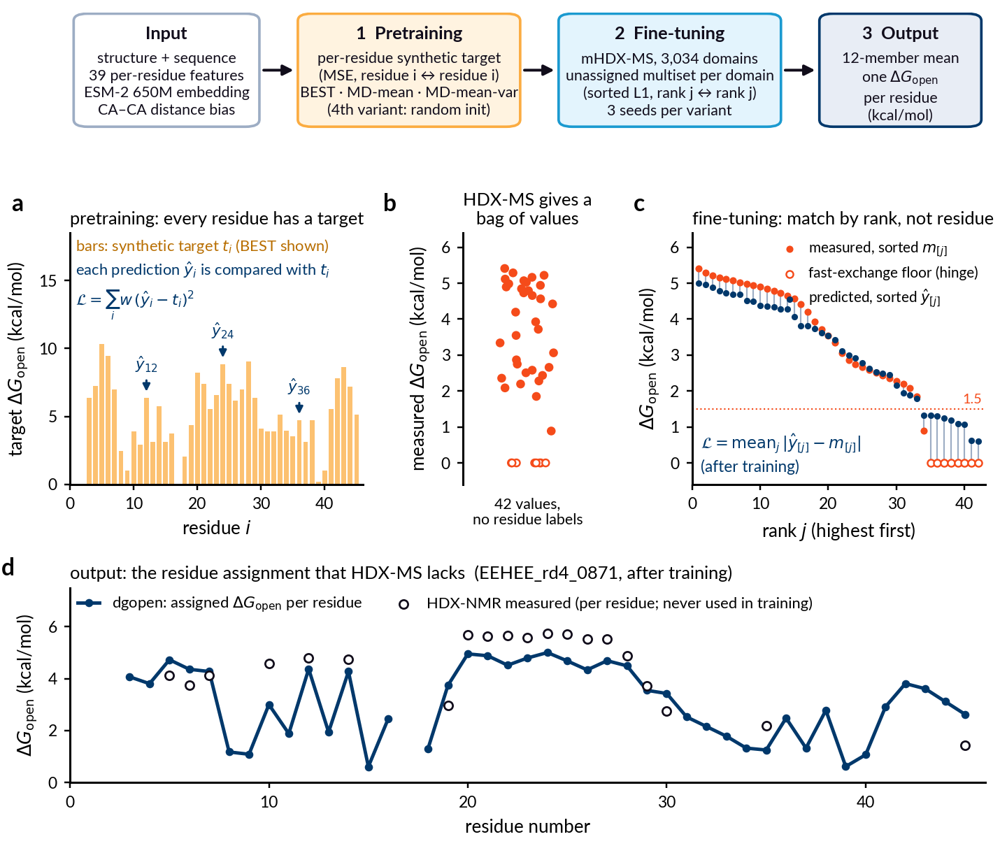

# dgopen

Predict the per-residue **opening free energy, ΔG_open** (kcal/mol), of backbone amides from a
single protein structure. ΔG_open is the free energy of the local or global unfolding event
that exposes an amide hydrogen to solvent exchange; it is the quantity hydrogen-deuterium
exchange (HDX) protection factors report on, via ΔG_open = RT ln PF under EX2 conditions.

The released model, **model-ens**, is an equal-weight average of 12 distance-biased graph
transformers: 4 training variants × 3 random seeds. Each model reads 39 per-residue
structural and sequence features plus ESM-2 650M embeddings, and uses CA–CA distances as an
attention bias. Read [MODEL_CARD.md](MODEL_CARD.md) before using the numbers: the model
**ranks** residues within a protein better than it predicts **absolute** ΔG_open.

## Install

```bash
git clone https://github.com/SoojungYang/dgopen.git && cd dgopen
pip install -e .            # numpy, pandas, torch, transformers
pip install -e ".[psea]"    # optional: biotite, only for --sse-method psea
```

The weights (12 files, 168 MB) are hosted on Hugging Face at
[`Soojung/dgopen`](https://huggingface.co/Soojung/dgopen) and are downloaded
automatically on first use into `~/.cache/dgopen/v0.1.0/`. For an offline machine, copy the
files there yourself or point `--weights-dir` / `$DGOPEN_WEIGHTS` at them. Every file is checked against the sha256 in
`src/dgopen/data/weights_manifest.json` before it is loaded. ESM-2 650M
(`facebook/esm2_t33_650M_UR50D`, about 2.5 GB) is downloaded from Hugging Face the first time
you run a prediction.

## Quickstart

```bash
dgopen predict --pdb examples/5PTI.pdb --out 5PTI_dgopen.csv      # ensemble prediction
dgopen best    --pdb examples/5PTI.pdb --out 5PTI_best.csv        # structure-only baseline
python examples/plot_example.py                                   # track plot
```

From Python:

```python
import dgopen
df = dgopen.predict_structure("examples/5PTI.pdb", chain="A")
```

A CPU is enough. 5PTI (58 residues) takes about 30 s, almost all of it loading and running ESM-2.

## Examples

- `examples/5PTI.pdb`: the quickstart structure (BPTI, PDB 5PTI).
- `examples/hdx_nmr/`: 13 domains with site-resolved HDX-NMR measurements, with dgopen and
  Best-Vendruscolo predictions shown against the measured values. For the 3 *held-out*
  domains, no measured data of any kind was used in training. For the other 10, only their
  unassigned HDX-MS distributions were (no residue-level values). See its README.


## How the model was trained

Residue-resolved ΔG_open measurements are scarce, so training combines residue-resolved
*synthetic* targets with large-scale *measured* data that do not say which value belongs to
which residue.



*(a) Pretraining has a synthetic target for every residue, so each prediction is compared
with the target at the same residue. (b) HDX-MS measures only the set of opening energies of
a domain, with no residue labels. (c) Fine-tuning therefore sorts the predictions and
compares them with the sorted measurements rank by rank. (d) The trained model outputs one
ΔG_open per residue, shown here against HDX-NMR values, which are never used in training.
Data are for one fine-tuning domain, EEHEE_rd4_0871; the script is `docs/make_training_schematic.py`.*

1. **Pretraining** (three of the four variants) regresses a per-residue synthetic ΔG_open
   target with a weighted mean-squared-error loss:
   - *BEST*: the Best-Vendruscolo structural estimate [3] on the 3,590 HDX-MS domain structures.
     The features it is computed from (amide contact and H-bond counts) are hidden from the
     model during this stage, so it cannot simply copy them.
   - *MD-mean*: Best-Vendruscolo-style protection averaged over folded-state molecular
     dynamics frames from MegaSim [2] (21,729 simulated domains: 271 wild types and 21,458
     point mutants), rescaled to the HDX-MS ΔG_open scale.
   - *MD-mean-var*: the same target plus its per-residue variance across frames, as a second
     output (multitask).
   - The fourth variant starts from random weights.
2. **Fine-tuning** (all variants) uses the mHDX-MS measurements of Ferrari et al. (2026) [1]:
   per-domain distributions of ΔG_open for small domains of 28–64 residues (3,034 domains
   for training, 159 for early stopping). Mass spectrometry measures how many amides have
   each ΔG_open but not which residue each value belongs to. The loss therefore compares
   the *sorted* predictions with the *sorted* measurements (a permutation-invariant mean
   absolute difference). Measurements at the fast-exchange floor (0 kcal/mol, a measurement
   artefact) only penalise predictions above 1.5 kcal/mol. No residue-level label is used.
   Adam, learning rate 3·10⁻⁴ with warm-up and cosine decay, up to 60 epochs; the checkpoint
   with the lowest validation loss is kept.
3. **Ensemble**: each of the 4 variants is fine-tuned with 3 random seeds, and the released
   prediction is the mean of the 12 models.

Inputs at every stage are the 39 per-residue features and ESM-2 650M embeddings listed in
MODEL_CARD.md; CA–CA distances enter as an attention bias. The HDX-NMR values used to
evaluate the model are never used in any training loss.

## Input

- One chain of one structure in PDB format. Pass `--chain` if the file has several chains.
  The model was trained on single domains (see the model card); oligomer interfaces,
  ligands, metals and cofactors are not represented.
- Only the 20 standard amino acids. Hydrogens, waters and HETATM ligands are dropped. Each
  atom keeps its first alternate location only. MODEL 1 is used from multi-model files.
- dgopen **refuses** (with a message saying why) on insertion codes, non-standard residues
  inside the chain (e.g. MSE), residues without a CA atom, or several chains when no
  `--chain` is given. It never renumbers residues. Chain breaks are detected from the
  geometry (C(i−1)–N(i) > 2.0 Å or missing atoms), not only from gaps in the numbering.
- The orientation and position of the input do not matter: features are computed in a
  canonical principal-axes frame.
- pLDDT is **not** used. The feature exists in the architecture but was constant during
  training, so it carries no information.

## Output

One row per residue:

| column | meaning |
|---|---|
| `resi`, `resn`, `aa1` | residue number (as in the file), 3- and 1-letter name |
| `exchangeable` | False for prolines and the first two residues (no measurable amide) |
| `after_chain_break` | True if the residue follows a gap in the chain; its amide H-bond features are set to the training mean, so treat its value with extra caution |
| `dg_open_kcal` | ensemble-mean ΔG_open, kcal/mol; NaN where not exchangeable |
| `dg_open_member_sd` | SD across the 12 members. A spread diagnostic, **not** a calibrated error bar |
| `<arm>_C2_s<seed>` | per-member predictions, with `--members` |

## Options that change numbers

`--sse-method torsion` (default) computes secondary structure from backbone torsions and
SASA (solvent-accessible surface area) with a 92-point Shrake-Rupley calculation. This is
the method that built the training features. `--sse-method psea` uses P-SEA SSE and biotite
SASA instead; it reproduces the external-benchmark numbers in the accompanying manuscript,
whose evaluation featurised structures that way. Over the 12-protein WT-external benchmark,
the published evaluation (psea, v0.1 featurisation) gives macro Spearman ρ 0.402 and the
v0.2.0 defaults give 0.400. See MODEL_CARD.md and CHANGELOG.md.

## Baseline

`dgopen best` implements the Best-Vendruscolo phenomenological model
(Best & Vendruscolo, *Structure* 2006): ln PF = 0.35 N_contacts + 2.0 N_H-bonds. It needs no
weights. Compare against it on any new protein before trusting the model there.

## Data sources and references

1. **mHDX-MS fine-tuning data, HDX-NMR example data, domain structures.** Ferrari, Á. J. R.
   *et al.* Large-scale discovery, analysis and design of protein energy landscapes.
   *Nature* **654**, 1108–1118 (2026). [doi:10.1038/s41586-026-10465-z](https://doi.org/10.1038/s41586-026-10465-z).
   Data: Zenodo [doi:10.5281/zenodo.14983481](https://doi.org/10.5281/zenodo.14983481) (CC BY 4.0).
2. **MegaSim molecular dynamics (pretraining targets).** Lewis, S. *et al.* Scalable emulation
   of protein equilibrium ensembles with generative deep learning. *Science* **389**, eadv9817
   (2025). [doi:10.1126/science.adv9817](https://doi.org/10.1126/science.adv9817).
   Data: Zenodo [doi:10.5281/zenodo.15641184](https://doi.org/10.5281/zenodo.15641184) (CDLA-Permissive-2.0).
3. **Best-Vendruscolo model.** Best, R. B. & Vendruscolo, M. Structural interpretation of
   hydrogen exchange protection factors in proteins: characterization of the native state
   fluctuations of CI2. *Structure* **14**, 97–106 (2006). [doi:10.1016/j.str.2005.09.012](https://doi.org/10.1016/j.str.2005.09.012).
4. **ESM-2.** Lin, Z. *et al.* Evolutionary-scale prediction of atomic-level protein structure
   with a language model. *Science* **379**, 1123–1130 (2023). [doi:10.1126/science.ade2574](https://doi.org/10.1126/science.ade2574).
5. **Domain library** (the designed and natural domains measured in [1]). Tsuboyama, K. *et al.*
   Mega-scale experimental analysis of protein folding stability in biology and design.
   *Nature* **620**, 434–444 (2023). [doi:10.1038/s41586-023-06328-6](https://doi.org/10.1038/s41586-023-06328-6).

## Citation

If you use dgopen, please cite this release (CITATION.cff). A manuscript citation will be
added when available. Please also cite the data sources above ([1], [2]).

## License

Code and model weights: MIT (LICENSE). ESM-2 is MIT-licensed (Meta AI). Training-data
sources and their licences are listed in MODEL_CARD.md.
