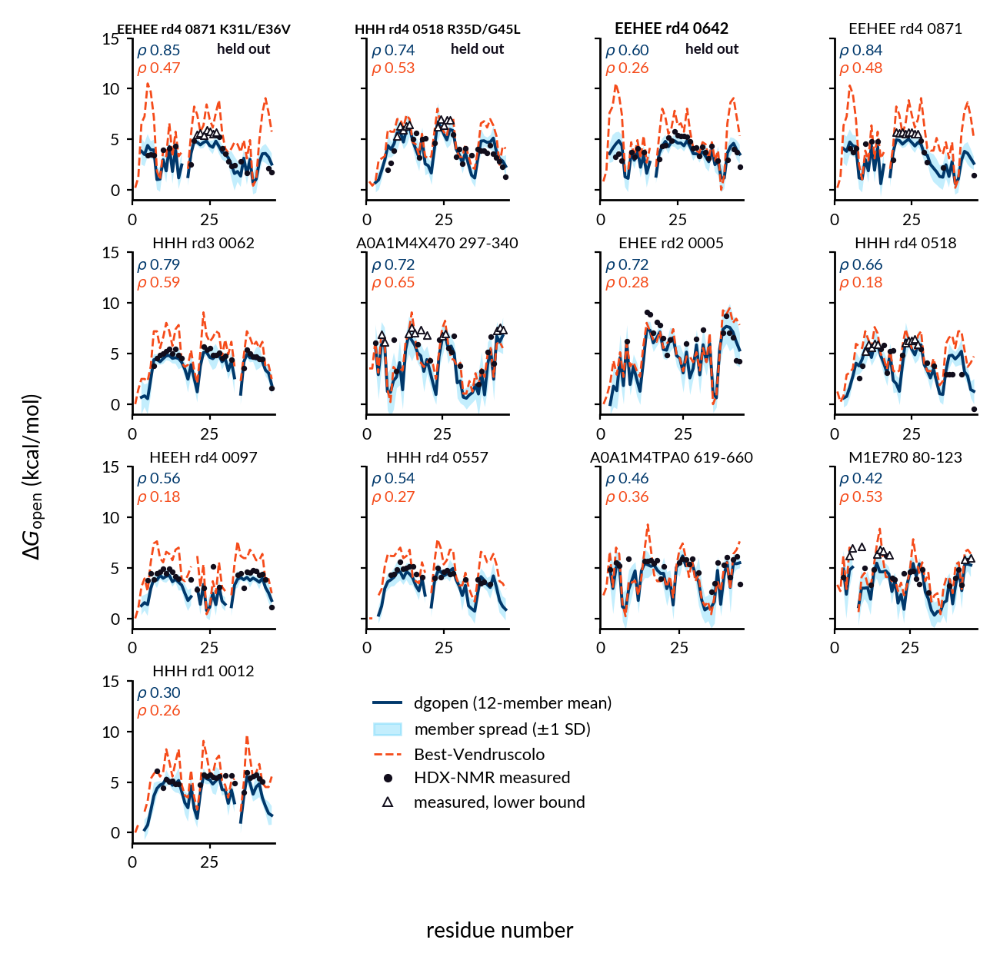

# dgopen

Predict the per-residue **opening free energy, ΔG_open** (kcal/mol), of backbone amides from a
single protein structure. ΔG_open is the free energy of the local or global unfolding event
that exposes an amide hydrogen to solvent exchange; it is the quantity hydrogen-deuterium
exchange (HDX) protection factors report on, via ΔG_open = RT ln PF under EX2 conditions.

The released model, **model-ens**, is an equal-weight average of 12 distance-biased graph
transformers: 4 training variants × 3 random seeds. Each model reads 39 per-residue
structural and sequence features plus ESM-2 650M embeddings, and uses CA–CA distances as an
attention bias. Read [MODEL_CARD.md](MODEL_CARD.md) before using the numbers: the model
**ranks** residues within a protein better than it predicts **absolute** ΔG_open.

## Install

```bash
git clone https://github.com/SoojungYang/dgopen.git && cd dgopen
pip install -e .            # numpy, pandas, torch, transformers
pip install -e ".[psea]"    # optional: biotite, only for --sse-method psea
```

The weights (12 files, 168 MB) are hosted on Hugging Face at
[`Soojung/dgopen`](https://huggingface.co/Soojung/dgopen) and are downloaded
automatically on first use into `~/.cache/dgopen/v0.1.0/`. For an offline machine, copy the
files there yourself or point `--weights-dir` / `$DGOPEN_WEIGHTS` at them. Every file is checked against the sha256 in
`src/dgopen/data/weights_manifest.json` before it is loaded. ESM-2 650M
(`facebook/esm2_t33_650M_UR50D`, about 2.5 GB) is downloaded from Hugging Face the first time
you run a prediction.

## Quickstart

```bash
dgopen predict --pdb examples/5PTI.pdb --out 5PTI_dgopen.csv      # ensemble prediction
dgopen best    --pdb examples/5PTI.pdb --out 5PTI_best.csv        # structure-only baseline
python examples/plot_example.py                                   # track plot
```

From Python:

```python
import dgopen
df = dgopen.predict_structure("examples/5PTI.pdb", chain="A")
```

A CPU is enough. 5PTI (58 residues) takes about 30 s, almost all of it loading and running ESM-2.

## Examples

- `examples/5PTI.pdb`: the quickstart structure (BPTI, PDB 5PTI).
- `examples/hdx_nmr/`: 13 domains with site-resolved HDX-NMR measurements, with dgopen and
  Best-Vendruscolo predictions shown against the measured values. See its README; 10 of the
  13 domains were in the fine-tuning set, so these are illustrations, not a benchmark.



## Input

- One chain of one structure in PDB format. Pass `--chain` if the file has several chains.
  The model was trained on single domains (see the model card); oligomer interfaces,
  ligands, metals and cofactors are not represented.
- Only the 20 standard amino acids. Hydrogens, waters and HETATM ligands are dropped. Each
  atom keeps its first alternate location only. MODEL 1 is used from multi-model files.
- dgopen **refuses** (with a message saying why) on insertion codes, non-standard residues
  inside the chain (e.g. MSE), residues without a CA atom, or several chains when no
  `--chain` is given. It never renumbers residues. Chain breaks are detected from the
  geometry (C(i−1)–N(i) > 2.0 Å or missing atoms), not only from gaps in the numbering.
- The orientation and position of the input do not matter: features are computed in a
  canonical principal-axes frame.
- pLDDT is **not** used. The feature exists in the architecture but was constant during
  training, so it carries no information.

## Output

One row per residue:

| column | meaning |
|---|---|
| `resi`, `resn`, `aa1` | residue number (as in the file), 3- and 1-letter name |
| `exchangeable` | False for prolines and the first two residues (no measurable amide) |
| `after_chain_break` | True if the residue follows a gap in the chain; its amide H-bond features are set to the training mean, so treat its value with extra caution |
| `dg_open_kcal` | ensemble-mean ΔG_open, kcal/mol; NaN where not exchangeable |
| `dg_open_member_sd` | SD across the 12 members. A spread diagnostic, **not** a calibrated error bar |
| `<arm>_C2_s<seed>` | per-member predictions, with `--members` |

## Options that change numbers

`--sse-method torsion` (default) computes secondary structure from backbone torsions and
SASA (solvent-accessible surface area) with a 92-point Shrake-Rupley calculation. This is
the method that built the training features. `--sse-method psea` uses P-SEA SSE and biotite
SASA instead; it reproduces the external-benchmark numbers in the accompanying manuscript,
whose evaluation featurised structures that way. Over the 12-protein WT-external benchmark,
the published evaluation (psea, v0.1 featurisation) gives macro Spearman ρ 0.402 and the
v0.2.0 defaults give 0.400. See MODEL_CARD.md and CHANGELOG.md.

## Baseline

`dgopen best` implements the Best-Vendruscolo phenomenological model
(Best & Vendruscolo, *Structure* 2006): ln PF = 0.35 N_contacts + 2.0 N_H-bonds. It needs no
weights. Compare against it on any new protein before trusting the model there.

## Citation

If you use dgopen, please cite this release (CITATION.cff). A manuscript citation will be
added when available. Please also cite the training-data sources listed in MODEL_CARD.md.

## License

Code and model weights: MIT (LICENSE). ESM-2 is MIT-licensed (Meta AI). Training-data
sources and their licences are listed in MODEL_CARD.md.
